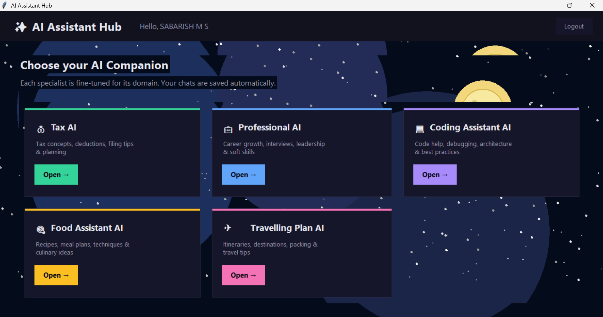
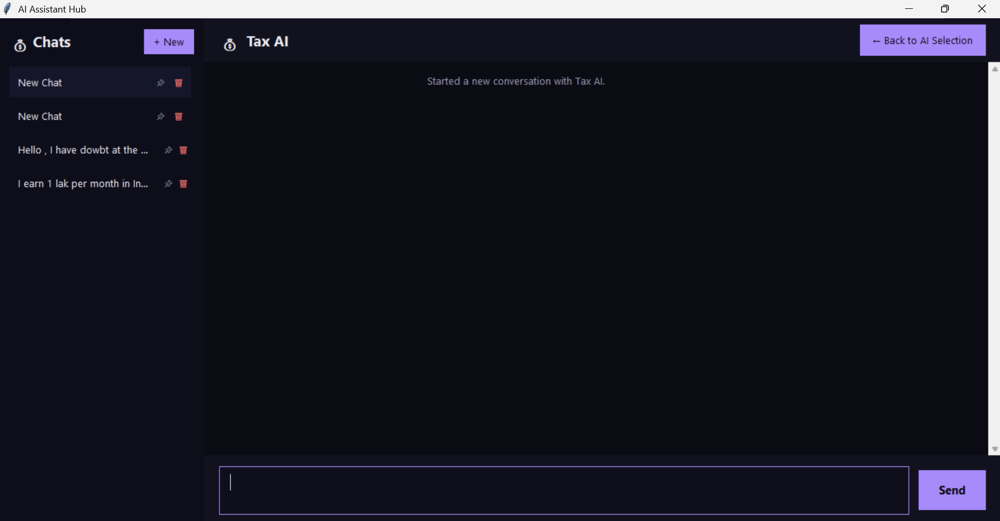

<div align="center">

# ✨ AI Assistant Hub

### Five helpful AI companions. One desktop app.

An AI-powered desktop assistant built with **Python**, **Tkinter**, **Groq**, and **PostgreSQL**.

[](https://www.python.org/)
[](https://docs.python.org/3/library/tkinter.html)
[](https://groq.com/)
[](https://www.postgresql.org/)

<br />

**Created by [Sabarish M S](https://sabarishdev.netlify.app)**  
📍 Salem, TN, India · [Portfolio](https://sabarishdev.netlify.app)

</div>

---

## 👋 About

Hi, I'm **Sabarish M S**, a developer from **Salem, Tamil Nadu, India**. I built AI Assistant Hub to bring a set of focused AI helpers together in one friendly desktop experience.

🔗 **Portfolio:** [sabarishdev.netlify.app](https://sabarishdev.netlify.app)

## 🚀 What you can do

| 💬 Chat with specialists | 🔐 Keep your account secure | 🗂️ Stay organized |
|:---|:---|:---|
| Get focused help with coding, careers, taxes, food, and travel. | Register and verify your email before signing in. | Save chat history automatically, pin useful chats, or delete chats you no longer need. |

- **Five AI personas** with their own domain-specific prompts
- **Dark, colorful desktop interface** with a separate chat console for each assistant
- **PostgreSQL persistence** for users, conversations, and messages
- **Email verification codes** with a 15-minute expiry
- **Groq-powered responses**; demo replies are available when no API key is configured

## 🖼️ Screenshots

<div align="center">

| Choose an AI companion | Chat with an assistant |
|:---:|:---:|
|  |  |

</div>

## 🧠 Meet the assistants

| Assistant | Here to help with |
|:---|:---|
| 💰 **Tax AI** | Tax concepts, deductions, filing tips, and general planning |
| 💼 **Professional AI** | Career growth, interviews, leadership, and workplace skills |
| 💻 **Coding Assistant AI** | Programming, debugging, architecture, and best practices |
| 🍳 **Food Assistant AI** | Recipes, meal planning, cooking techniques, and culinary ideas |
| ✈️ **Travelling Plan AI** | Itineraries, destinations, packing, and travel tips |

## ⚙️ Get started

### Requirements

- Python 3.10+
- PostgreSQL
- A [Groq API key](https://console.groq.com/) for live AI responses (optional for demo mode)

### 1. Install dependencies

```bash
git clone <repository-url>
cd ai_assistant_app
pip install -r requirements.txt
```

### 2. Configure environment variables

Create a `.env` file in the project root. Add your Groq key and, if you want verification emails, SMTP credentials:

```dotenv
GROQ_API_KEY=your_groq_api_key

# Optional: configure SMTP to send verification codes by email
SMTP_HOST=smtp.gmail.com
SMTP_PORT=587
SMTP_USER=your_email@gmail.com
SMTP_PASSWORD=your_email_app_password
# SMTP_FROM=your_email@gmail.com
```

The app's default PostgreSQL connection settings are:

```dotenv
DB_HOST=localhost
DB_PORT=5432
DB_NAME=ai_assistant_db
DB_USER=aiapp
DB_PASSWORD=aiapppass
```

Change these values in `.env` if your local PostgreSQL setup differs, and make sure the database and user exist. **Do not commit your `.env` file or API credentials.**

### 3. Run the app

```bash
python main.py
```

The app creates its required database tables at startup. If SMTP isn't configured, verification codes are printed to the console for local testing.

## 🗂️ Project structure

```text
ai_assistant_app/
├── images/                 # App screenshots used in this README
├── main.py                 # Application entry point
├── requirements.txt        # Python dependencies
├── services/
│   ├── database.py         # PostgreSQL schema and data operations
│   ├── email_service.py    # Verification-code emails
│   └── groq_service.py     # Groq API and assistant prompts
└── ui/
    ├── app.py              # Login, dashboard, and chat screens
    └── styles.py           # UI colors, fonts, and style helpers
```

## 🙋 About the creator

<div align="center">

### Sabarish M S

📍 Salem, TN, India  
🌐 [Visit my portfolio](https://sabarishdev.netlify.app)

</div>

---

<div align="center">

Made with ☕ and Python by **Sabarish M S**

</div>
